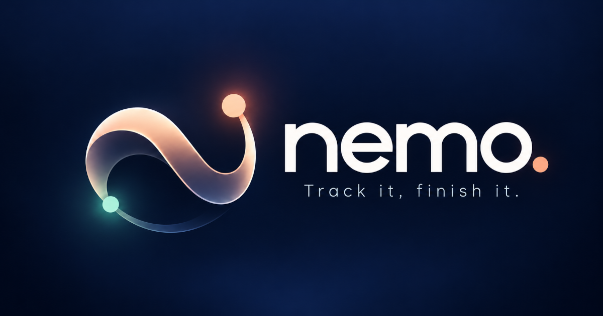

<div align="center">
  <h1>nemo. — Track it, finish it.</h1>
  <p><strong>Workspace peribadi untuk projek, tugasan, pengajian dan matlamat.</strong></p>
  <p>
    <a href="https://github.com/syahmiaof/nemo"></a>
    <a href="LICENSE"></a>
    <a href="https://github.com/syahmiaof/nemo/actions"></a>
    <a href="https://syahmiaof.my"></a>
  </p>
</div>



Nemo ialah aplikasi React, TypeScript dan Vite yang menyimpan kerja secara local-first dalam IndexedDB. Pengguna boleh terus menggunakan workspace setempat. Kod terkini juga menyediakan pilihan akaun dan sync melalui Supabase apabila konfigurasi dan sambungan tersedia.

## What is implemented

- Overview, Projects, Tasks, Academics, Calendar, Goals, Health, Finance, Insights and Settings routes.
- Canonical tasks linked to projects and goals, with a three-slot Today's Focus view.
- Calendar projections and insights derived from workspace records.
- Local backup/restore, demo workspace and offline PWA assets.
- Optional account and bidirectional sync integration; local use does not require sign-in.
- Responsive navigation, quick add/search and reduced-motion handling.

## Run

```bash
npm ci
npm run dev
npm run typecheck
npm test
npm run build
npm run preview
```

Optional cloud sync reads `VITE_SUPABASE_URL` and `VITE_SUPABASE_ANON_KEY`; see `.env.example`. Do not put service-role keys or other private credentials in Vite client variables. Without those values, use the local workspace.

## Verification

```bash
npx playwright install chromium
npm run test:e2e
```

The commands above are available in `package.json`; this README does not claim a fresh test run. See `docs/TEST_REPORT.md` for recorded evidence and its date.

## Structure

- `src/app/` — routes, shell and navigation.
- `src/features/` — workspace screens and account UI.
- `src/db/` and `src/domain/` — local records and domain types.
- `src/sync/` — optional Supabase synchronization.
- `tests/` and `docs/` — tests and project documentation.

## Limits

Workspace data is stored on the device unless account sync is configured and used. Browser storage can be cleared, so export a backup for important local records. Demo data is illustrative; Health and Finance views are workspace tools, not professional advice.

## Builder

[Muhammad Syahmi](https://syahmiaof.my)
