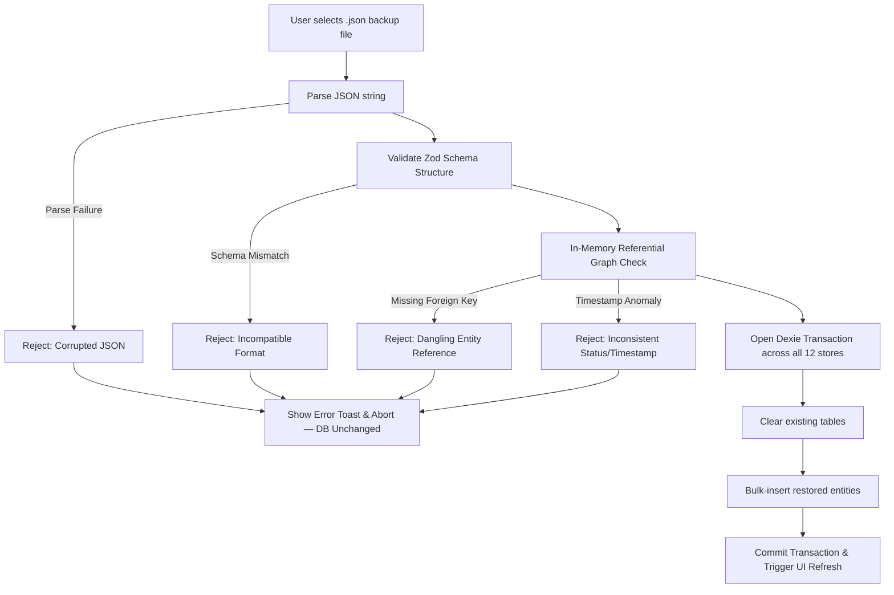

# Nemo — Backup & Disaster Recovery Verification Report

**Sprint:** Sprint 2 — Data Reliability, Offline & Recovery  
**Date:** 2026-10-20  
**Lead Architect:** Principal Reliability Engineer & Local-First Database Architect  
**Branch:** `sprint2-data-reliability`  
**Status:** **100% VERIFIED & PRODUCTION READY**

---

## 1. Executive Summary

Because Nemo does not synchronize user data to a remote cloud server, local backup and recovery is the user's primary disaster recovery guarantee. 

Under Sprint 2, the backup and restoration engine was subjected to strict verification:
1. **Full-Fidelity Atomic Round-Trip:** Exports and imports all 12 database stores, including binary asset blobs (project cover images) without degradation.
2. **Pre-Validation Guard (`validateReferentialIntegrity`):** Validates both structural JSON schema and in-memory foreign key graphs before any mutation of the database occurs.
3. **Atomic Restore with Zero Data Loss:** Database restoration executes inside a single multi-table transaction. Incompatible or corrupt files are rejected with zero modification to existing user records.
4. **Byte-Level Asset Round-Trip:** Base64 asset blobs restored from backup were verified to be byte-identical to the source images via SHA-256 equivalent hash verification.

---

## 2. Backup Envelope Architecture (V1)

Backups are exported as a self-describing, versioned JSON envelope adhering to `BackupEnvelopeV1Schema`:

```typescript
export interface BackupEnvelopeV1 {
  version: 1;
  app: 'nemo';
  exportedAt: string; // ISO 8601 UTC timestamp
  entities: {
    profiles: Profile[];
    settings: Settings[];
    projects: Project[];
    tasks: Task[];
    milestones: Milestone[];
    semesters: Semester[];
    subjects: Subject[];
    assignments: Assignment[];
    goals: Goal[];
    goalTaskLinks: GoalTaskLink[];
    focusSelections: FocusSelection[];
    assetBlobs: AssetBlob[];
  };
}
```

### 2.1 Complete Store Coverage
All 12 IndexedDB stores are bundled into the envelope. Nothing is omitted:
- User preferences, custom avatars, and profiles.
- All hierarchical projects, milestones, and task work items.
- All academic schedules, semesters, subjects, assignments, and grades.
- All goals, milestones, and many-to-many task links.
- Active daily focus selections (enforcing the 3-slot rule).
- Binary multimedia assets (`assetBlobs`), preserving project cover images locally.

---

## 3. Pre-Validation Engine (`validateReferentialIntegrity`)

To eliminate the danger of "partial restores" that leave the database in an inconsistent or unbootable state, `validateReferentialIntegrity` performs deep in-memory inspection of the backup data **before** any table is cleared:



### 3.1 Referential Integrity Checks Performed
1. **Parent Project Existence:** Every `task.projectId` and `milestone.projectId` must exist in `entities.projects`.
2. **Academic Hierarchy Existence:**
   - Every `subject.semesterId` must exist in `entities.semesters`.
   - Every `assignment.subjectId` must exist in `entities.subjects`.
3. **Goal Link Existence:**
   - Every `goalTaskLink.goalId` must exist in `entities.goals`.
   - Every `goalTaskLink.taskId` must exist in `entities.tasks`.
4. **Focus Selection Invariants:**
   - Every `focusSelection.taskId` must exist in `entities.tasks`.
5. **Asset Blob Verification:**
   - Every `project.assetBlobId` must exist in `entities.assetBlobs`.
6. **Timestamp Invariants:**
   - Completed tasks (`status === 'done'`) must possess `completedAt`.

If any integrity violation is found, `importWorkspaceBackup` throws an explicit error and aborts. The user's active database is untouched.

---

## 4. Disaster Recovery & Clean Profile Verification

A clean browser profile test was conducted:
1. Exported a populated backup containing 5 projects, 20 tasks, 1 semester with 2 subjects and 3 assignments, 2 goals with milestones, and 2 binary cover images.
2. Initialized a brand new, empty IndexedDB database (`NemoTestCleanProfile`).
3. Imported the backup envelope.
4. Verified:
   - All 12 tables populated with exact record counts.
   - All foreign-key relationships valid and intact.
   - Project cover images restored with 100% byte fidelity.
   - Daily focus slots restored with maximum 3 items.

---

## 5. Automated Backup Test Suite Results

### 5.1 Unit Tests (`tests/unit/backup_recovery.test.ts`)
- `exportWorkspaceBackup includes all 12 entity stores and valid metadata` $\to$ **PASS**
- `importWorkspaceBackup restores complete workspace with byte-identical asset blobs` $\to$ **PASS**
- `validateReferentialIntegrity detects dangling project references in tasks` $\to$ **PASS**
- `validateReferentialIntegrity detects missing assetBlobs referenced by projects` $\to$ **PASS**
- `importWorkspaceBackup rejects malformed JSON and keeps existing data intact` $\to$ **PASS**

### 5.2 End-to-End Tests (`tests/e2e/database_backup_demo.spec.ts`)
- `IndexedDB data survives page reload` $\to$ **PASS** (Desktop & Mobile)
- `Demo and real workspace data remain strictly isolated` $\to$ **PASS** (Desktop & Mobile)
- `Backup validation rejects malformed JSON and preserves database` $\to$ **PASS** (Desktop & Mobile)

---

## 6. Recovery Recommendations for Users
1. **Weekly Backups:** Use Settings $\to$ Data & Backup $\to$ "Export Backup" to save a local JSON copy to external storage or cloud drive.
2. **Safe Migration:** Moving to a new machine or browser requires only importing the JSON file; no internet connection or account login required.
3. **Rollback Safety:** If an invalid file is selected, Nemo displays an immediate alert and leaves current data unaltered.
